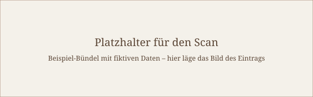

# Taufe MUSTER, Johann Heinrich – Beispieldorf, 14.03.1788

**Zitat:** Bistumsarchiv Musterstadt, Pfarrei St. Peter Beispieldorf, KB 4
(Taufen 1770–1809), S. 112, Nr. 23: Taufe Johann Heinrich Muster, 14.03.1788.
Digitalisat, Bild 58 (eingesehen 2026-11-14). Original.

## Transkription (buchstabengetreu)

> 14. Martii baptizatus est Joes Henricus, filius legitimus Petri Muster et
> Annae Mariae Beispiel conjugum. Patrinus: Joes Schmitz.

## Übersetzung

Am 14. März wurde getauft Johann Heinrich, ehelicher Sohn der Eheleute Peter
Muster und Anna Maria Beispiel. Pate: Johann Schmitz.

## Extrahierte Angaben

| Genannt als | Rolle | Person | Information |
|-------------|-------|--------|-------------|
| Joes Henricus | Täufling | [MUSTER, Johann Heinrich (*1788 Beispieldorf)](../../20_personen/P0001_MUSTER-Johann-Heinrich_1788.md) – belegt | primär |
| Petrus Muster | Vater | [MUSTER, Peter (~1760)](../../20_personen/P0002_MUSTER-Peter_1760.md) – belegt | primär |
| Anna Maria Beispiel | Mutter | [BEISPIEL, Anna Maria (~1765)](../../20_personen/P0003_BEISPIEL-Anna-Maria_1765.md) – belegt | primär |
| Joes Schmitz | Pate | nicht identifiziert – kein Link, bis die Identität feststeht | primär |

Ort: [Beispieldorf](../../30_familien-orte/Beispieldorf.md)

## Bewertung

Original, zeitnah geführt. Primärinformation zur Taufe, direkter Beleg für
die Eltern. Informant nicht genannt.
