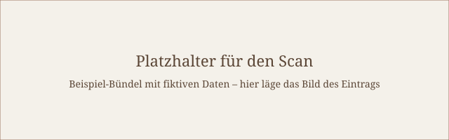

# Heirat MUSTER / EXEMPEL – Musterstadt, 16.05.1815

**Zitat:** Stadtarchiv Musterstadt, Zivilstandsregister Musterstadt, Heiraten
1815, Nr. 204: Heirat Muster/Exempel, 16.05.1815. Digitalisat (eingesehen
2026-11-14). Original. Lesung maschinell, ungeprüft.

## Transkription (maschinell gelesen, ungeprüft)

> … erschienen Johann Muster, Ackerer, 27 [?] Jahre alt, wohnhaft zu
> Beispieldorf, Sohn des Peter Muster, und Anna Maria Exempel, 23 Jahre alt,
> wohnhaft zu Musterstadt …

## Extrahierte Angaben

Keine Links auf Personen: Die Lesung ist nicht am Bild geprüft, also steht
noch nicht fest, wer hier genannt ist.

| Genannt als | Rolle | Person | Information |
|-------------|-------|--------|-------------|
| Johann Muster, 27 [?] Jahre, Sohn des Peter | Bräutigam | Kandidaten P0001 und P0005 – siehe [H0001](../../40_hypothesen/H0001_Braeutigam-1815-Namensvetter.md) | primär |
| Anna Maria Exempel, 23 Jahre | Braut | noch keine Notiz | primär |
| Peter Muster | Vater des Bräutigams | Name passt zu P0002 – offen | sekundär |

Ort: [Musterstadt](../../30_familien-orte/Musterstadt.md)

## Bewertung

Original. Alter des Bräutigams unsicher gelesen (27 oder 21). Namen, Alter und
Vatersname gelten erst nach Prüfung am Bild.
